# Glucose Monitor — a FreeStyle Libre 3 as a stream

A [FreeStyle Libre 3](https://www.freestyle.abbott/) sensor measures glucose every minute and
sends it over Bluetooth to the Libre 3 app, which uploads it to Abbott's LibreView cloud. Abbott
offers individual users no API. A **LibreLinkUp follower** — the account a Libre 3 user invites to
watch their readings — can read them, though, and that is the door this example uses. The
non-nerd pitch: *your own sensor's readings in your own database, kept far past LibreLinkUp's
12-hour memory, with time in range, GMI and a daily profile on a dashboard.*

It is the repo's answer to three questions the others don't ask: *how do you stream from a
source whose only interface is a sign-in?* — *how do you make a stream out of a snapshot that
repeats itself on every poll?* — and *what does a pipeline owe data that is someone's health?*

> **Not a medical device.** This is an analytics pipeline over an unofficial API. Its readings
> arrive minutes late and may stop without warning. Never dose insulin, or decide anything about
> treatment, from it. The Libre 3 app and its alarms stay your source of truth.

```mermaid
flowchart LR
    KR[/"keyring.json<br/>(flechtctl keyring new)"/]:::ext --> RQ["request.py<br/>signs in once to check,<br/>email + password → ENCRYPTED(STR)"]:::process
    RQ --> CFG(["glucose-accounts<br/>(compacted config)<br/>one record per follower account"]):::topic
    S{{"Libre 3 → phone → LibreView"}}:::ext --> LLU{{"LibreLinkUp<br/>/llu/connections<br/>/llu/connections/{id}/graph"}}:::ext
    CFG --> IN["GlucoseIngest (Extractor)<br/>backup only: graph data as delivered<br/>no cursor; state = the session, ENCRYPTED<br/>ticket never backed up"]:::process
    LLU --> IN
    IN --> RAW(["glucose-raw<br/>{metadata, response}<br/>key = patient id"]):::topic
    RAW --> RD["GlucoseReadings (Transformer)<br/>live + history readings<br/>SEEN = 24 h of stamps per kind"]:::process
    RD --> OUT(["glucose-readings<br/>key = patient id"]):::topic
    OUT --> CH[("ClickHouse: glucose_readings")]:::store
    CH --> GRAF{{"Grafana"}}:::ext
    classDef process fill:#dbeafe,stroke:#2563eb,color:#0b1324;
    classDef topic fill:#fef3c7,stroke:#d97706,color:#0b1324;
    classDef store fill:#e5e7eb,stroke:#6b7280,color:#0b1324;
    classDef ext fill:#dcfce7,stroke:#16a34a,color:#0b1324;
```



## What it demonstrates

1. **A stream made from a repeating snapshot.** LibreLinkUp has no "since": every `graph` call
   returns the latest measurement plus the whole last ~12 hours of history, again. The
   extractor backs that up as delivered, every minute, with **no cursor** (there is no listing
   progress to remember). The `readings` transformer turns the repeats into news with a
   **seen-set**: every emitted timestamp of the last 24 hours of *event time*, per patient and
   kind. A high-water mark would not do — LibreLinkUp sometimes fills in a history point *behind*
   the newest one, and the seen-set still catches it once.
2. **The raw backup is the only history there will ever be.** LibreLinkUp forgets everything older
   than its 12-hour window, so the source can never be re-fetched. Keeping the extractor a pure
   backup (`{metadata, response}`, no field of a reading read) means every rule downstream — the
   horizon, the kinds, a future low-glucose episode detector — is a replay of `glucose-raw`.
3. **A sign-in, not a key.** LibreLinkUp's credential is an email and a password, both
   `ENCRYPTED(STR)` attributes of the account's record on `glucose-accounts` (the TMDB shape: the
   credential rides on every target record). `request-glucose account` reads them from the
   terminal — never argv — **signs in once to check them**, learns the account's LibreView region
   from the login redirect, and only then writes the ciphertext. The extractor keeps the
   resulting **session as its state, encrypted** — `SESSION` is an `ENCRYPTED` attribute, so
   the changelog holds one `flenc:jwe:…` token and never the bearer token, the account id or the
   credentials' digest in the clear. Signing in on every poll, or on every restart of a crash
   loop, would be how accounts get locked; this way a restart resumes with the stored session.
   It signs in again only shortly before the session expires, as soon as the stored credentials
   change, or when LibreView answers 401 — and only then writes the changelog, since re-encrypting
   an unchanged session would be fresh ciphertext every poll. The renewed ticket each response
   carries is ignored (the sign-in's ticket serves until it expires) and never backed up.
   **Every secret is encrypted wherever it rests**; what is *not* encrypted is the health data
   itself — see the caveats.
4. **Two series, kept apart.** A `live` reading is the latest measurement at each poll (about
   one a minute, with a trend arrow); a `history` reading is a point of LibreLinkUp's coarser
   `graphData` series. They are different series, so each reading carries its `kind`, and the
   dashboard's statistics read `history` — gap-free across any outage shorter than 12 hours, and
   on a regular grid, so every point weighs the same.
5. **Local time without a time zone.** Each item has two clocks: `FactoryTimestamp` (the
   sensor's UTC) and `Timestamp` (the phone's local time). Their difference is the phone's UTC
   offset at that moment, which `readings` stores as `utc_offset_min`. The daily profile groups by
   the *local* hour from it, so travel across time zones does not smear the profile.

## The data

A `glucose-readings` record is the LibreLinkUp item spread through as delivered, plus what
`readings` computed (the live reading of the fixture):

```json
{
  "FactoryTimestamp": "10/29/2026 7:13:41 AM", "Timestamp": "10/29/2026 8:13:41 AM",
  "type": 1, "ValueInMgPerDl": 203, "TrendArrow": 4, "TrendMessage": null,
  "MeasurementColor": 2, "GlucoseUnits": 1, "Value": 203, "isHigh": false, "isLow": false,
  "patient_id": "0f1e2d3c-4b5a-4968-8776-a5b4c3d2e1f0", "kind": "live",
  "measured_at": "2026-10-29T07:13:41Z", "utc_offset_min": 60, "fetched_at": "2026-10-29T07:14:00Z"
}
```

`ValueInMgPerDl` is always mg/dL; `Value` is in the unit the patient's app shows (`GlucoseUnits`
1 = mg/dL, 0 = mmol/L). `TrendArrow` runs 1 (falling fast) … 3 (stable) … 5 (rising fast) and is
absent on history points. ClickHouse promotes `mg_dl`, `trend_arrow`, `is_high`, `is_low`,
`utc_offset_min` and the timestamps into `flechtwerk.glucose_readings` and keeps the whole record
in `payload`. The table has **no TTL**: it is the long history LibreLinkUp doesn't keep.

The dashboard (*Flechtwerk — Glucose Monitor*) shows the reading now with its trend and age; the
mean, the GMI (3.31 + 0.02392 × mean mg/dL), the coefficient of variation and the time in range
over the selected range; a chart of both series over the 70–180 mg/dL band; the time in the five
consensus ranges (<54, 54–69, 70–180, 181–250, >250); the daily profile of the last 14 days
(median with the 25–75 % and 5–95 % bands, by local hour); and one row per local day.

## Getting a follower account and a keyring

1. **A LibreLinkUp follower.** In the FreeStyle Libre 3 app, open the connected-apps or sharing
   settings and invite a LibreLinkUp follower — a second email address of your own works. Install
   LibreLinkUp, sign in as that follower, accept the invitation and any terms it asks for. (If
   LibreView later wants new terms accepted, the extractor stops with a message saying so; sign in
   to the app once more.)
2. **A keyring.** It holds the key that encrypts the credentials on the topic:

   ```bash
   mkdir -p ~/.config/flechtwerk-examples
   uv run flechtctl keyring new --kid dev-$(date -u +%Y-%m) ~/.config/flechtwerk-examples/keyring.json
   chmod 600 ~/.config/flechtwerk-examples/keyring.json
   ```

   The path is `~/.config/flechtwerk-examples/keyring.json` unless `FLECHTWERK_KEYRING` names
   another one. The ops callers (`__main__.py`, `request.py`) read that path; **stages read no
   environment**.
3. **Store the account.** `uv run poe request-glucose account me` asks for the follower's email
   and password (the password unechoed), signs in, and prints the region and whom the account
   follows — never a credential. Re-run it to change the password.

## Run it

With the [stack](../../README.md#the-stack) up:

```bash
uv run poe up
uv run poe setup-glucose                  # topics + ClickHouse schema (nothing seeded)
uv run poe request-glucose account me     # asks for the follower's email + password
uv run poe glucose                        # setup, then both stages (restart-on-crash)
```

or stage by stage: `uv run poe run-glucose-ingest` (the backup extractor, polling every minute,
metrics on `9127`) and `uv run poe run-glucose-readings` (the dedupe transformer, `9128`). The
`__main__` targets are `python -m examples.glucose_monitor ingest|readings`. `request-glucose
retire me` tombstones an account, and `request-glucose` alone lists what is stored. Then open
Grafana (`http://localhost:3000`, dashboard *Flechtwerk — Glucose Monitor*) or query ClickHouse:

```sql
SELECT measured_at, mg_dl, trend_arrow FROM flechtwerk.glucose_readings WHERE kind = 'live' ORDER BY measured_at DESC LIMIT 10;
SELECT toDate(addMinutes(measured_at, ifNull(utc_offset_min, 0))) AS day, round(avg(mg_dl)) AS mean,
       round(100 * countIf(mg_dl BETWEEN 70 AND 180) / count(), 1) AS tir_pct
FROM flechtwerk.glucose_readings WHERE kind = 'history' GROUP BY day ORDER BY day DESC;
```

## Caveats (read these)

- **Unverified against the live API.** The tests drive the stages against a LibreLinkUp double
  built to the response shapes the community clients document (`tests/fixtures/PROVENANCE.md`);
  no real account has been polled yet. Expect the first live run to correct something — check a
  `glucose-raw` record in Kafbat against the fixture.
- **An unofficial, reverse-engineered API.** Abbott publishes no LibreLinkUp API and can change it
  at any time; it already did once, in 2025, when it began demanding the `account-id` header. The
  `product`/`version` headers impersonate the LibreLinkUp app: when sign-in starts failing, bump
  `client.VERSION`. Using it may also be against LibreView's terms — read them for your account.
- **Health data.** `glucose-raw` holds what LibreLinkUp shows a follower — the patient's name,
  sensor serial and alarm settings included — and `glucose_readings` holds the readings forever.
  Keep the stack on your own machine; don't point it at shared infrastructure. The credentials
  and the session are encrypted wherever they rest; the readings are not — they are data to
  query, not secrets, and encrypting them would leave nothing for ClickHouse to compute on.
- **Latency.** Sensor → phone (every minute) → LibreView → this poller (every minute): a reading
  lands a few minutes after it was measured. If the phone is out of Bluetooth range or offline,
  nothing arrives, and the *Last reading* panel says so.
- **Polling cost.** Two requests per followed patient per minute, and one sign-in per process
  start or session expiry. If LibreView answers 429, raise `POLL_INTERVAL` in `__main__.py`.
- **The history grid is LibreLinkUp's, not the sensor's.** `graphData` is coarser than the
  sensor's one-minute readings, and the live series has gaps wherever the poller was down. The
  statistics read `history` for that reason; the chart shows both.
- **Let it crash.** A 5xx, a timeout, a 401 or a 429 propagates and the supervisor restarts the
  stage, which resumes with its stored session; the readings seen-set restores from its
  changelog. A 401 is the one failure the ingest remedies itself, by signing in again. LibreView
  refusing the credentials or wanting new terms accepted stops the ingest with the remedy in the
  message.

## Extension points (deliberately not shipped)

- **Low and high episodes** — sessionize readings below 70 (or 54) and above 180 (or 250) into
  episodes with a start, an end and a nadir, the `wildfire_watch` lifecycle applied to a series.
- **Sensor lifetimes** — `activeSensors` in the raw backup says which sensor was worn; per-sensor
  statistics and warm-up periods come from there.
- **The logbook** — the community clients also call `/llu/connections/{id}/logbook`, a list of
  past events; another raw topic beside `glucose-raw`.
- **Nightscout as a sink** — the readings are the shape Nightscout's `entries` API takes.
