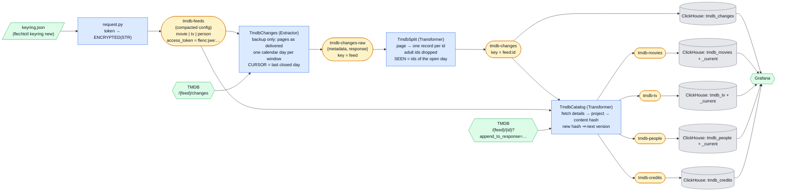

# TMDB - The Movie Database — reference data as a change stream

[The Movie Database](https://www.themoviedb.org/) is the community-built catalog behind half the
film apps on your phone. This example keeps a **local copy of it current**: movies, TV series and
people, plus the credits that link them, refreshed from TMDB's daily change feeds and landed as
versioned rows in ClickHouse. The non-nerd pitch: *your own queryable copy of the movie database,
that remembers how every title changed.*

It is the repo's answer to two questions the others don't ask: *how do you mirror slowly changing
reference data when all the source offers is "these ids changed on this day"?* — and *how does a
real credential travel on a config topic without ever being plaintext?*



## What it demonstrates

1. **Reference data as a change stream.** TMDB never says *what* changed, only *which ids* changed
   on a day. The catalog stage therefore fetches each listed entity, projects it to a flat row,
   and hashes the row (`content_hash`, 16 hex over the projected content and its credits). A hash
   equal to the one in the entity's state emits **nothing and writes nothing**; a new hash is the
   next **version** (`version`, `version_at`). That is a slowly-changing-dimension, type 2, built
   from one comparison — and it makes the routine repeat fetches below free. `popularity` is
   *inside* the hash on purpose: TMDB recomputes it daily, and a new version per move **is** the
   popularity history the dashboard reads.
2. **The first encrypted credential on a config topic.** The TMDB token is an
   `ENCRYPTED(STR)` attribute of each feed's record. The flow: a keyring file (made with
   `flechtctl`) → `request-tmdb token` reads the token from stdin and writes it as `flenc:jwe:…`
   ciphertext → each stage, started with the keyring (`_runner.run(keyring=…)`), decrypts it on
   read. The proof is on the metrics endpoint: `flechtwerk_secret_decrypts_total{kid=…}` counts the
   decrypts and `flechtwerk_keyring_keys_loaded` the keys. The token rides **on each feed record**
   rather than on a record of its own because the config store merges every config topic a stage
   declares into one namespace and the extractor polls *every* entry of it — a separate
   credentials record would be polled as if it were a feed.
3. **An extractor is a backup, not a parser.** `changes` never interprets what TMDB sends: each
   change-feed page goes to `tmdb-changes-raw` exactly as delivered, under `response`, beside a
   `metadata` record of what was asked and when (feed, day, page, `open`/`closed`, the server
   `Date`) — the `adsb-raw` shape. No `Attribute` describes the body; the one field read from it
   is the envelope's `total_pages`, without which paging is impossible. Everything that *reads*
   the data — splitting a page into per-id records, dropping `adult` ids, deduping — is the
   `split` transformer's job, so changing a rule is a replay of the backup, not a re-crawl.
4. **A calendar-day cursor with a seen-set for the open day.** TMDB caps a change window at 14 days
   and `page` at 500 (100 ids per page). Measured on 2026-10-23: a day of people is ~60 pages,
   but a 14-day people window is ~600 — over the cap. So the extractor lists **one calendar day
   per window** (inclusive at both ends, so `start_date == end_date`). Closed days are listed
   once; *today* is still accruing, so it is re-listed in full every poll, and `split` emits only
   the ids not in its `SEEN` set. When midnight UTC passes, the day gets **one full closing
   listing** — every id again, marked `closed` — so an entity edited after its last hourly fetch
   is fetched once more, and the hash gate turns a no-op second fetch into nothing. (TMDB keeps
   amending a past day's listing for a while after midnight, so even the closing listing is not
   the last word — see [Caveats](#caveats-read-these).)
5. **Commit-per-day backfill.** The poll yields one `State` per day. Every `State` yield is a
   commit boundary, so a 90-day backfill is 90 transactions, a crash resumes at the last closed
   day, and no transaction outlives the framework's 10-minute limit.

## The data

Three entity catalogs and the credits that link them, from TMDB's v3 API:

| TMDB feed | detail call (`append_to_response`) | topic | tables |
|---|---|---|---|
| `movie` | `credits,keywords,release_dates,external_ids` | `tmdb-movies` | `tmdb_movies` (history), `tmdb_movies_current` |
| `tv` | `aggregate_credits,keywords,content_ratings,external_ids` | `tmdb-tv` | `tmdb_tv`, `tmdb_tv_current` |
| `person` | `external_ids` | `tmdb-people` | `tmdb_people`, `tmdb_people_current` |
| (credits of a title) | — | `tmdb-credits` | `tmdb_credits` |

plus `tmdb-changes` → `tmdb_changes` (one row per id per listing), eight tables in all. The
extractor's backup, `tmdb-changes-raw`, stays in Kafka only: it is the replay source for `split`,
not something to query. Every record
is keyed `<feed>:<id>` (`movie:550`), which co-partitions a title's changes, versions and credits.

The Kafka topics are **flat JSON, one row per entity version and one per credit**, so a
downstream OLAP store can take them without a flatten step. TMDB's responses are spread through
as delivered (including fields TMDB adds tomorrow, like the undocumented `softcore`); only what
the stage *computes* is declared: `[{"id": 18, "name": "Drama"}]` lists become name arrays
(`genres`, `keywords`, `production_companies`, `networks`, …), `belongs_to_collection` becomes
`collection`, the release dates and content ratings become `certifications` / `content_ratings`
maps (`{"US": "R"}`), and the non-null external ids (`imdb_id`, `wikidata_id`, `tvdb_id`) move to
the top level.

**Credits are a fan-out.** A movie's cast and crew leave the flat row and become one
`tmdb-credits` row each (`credit_id`, `kind` = `cast` | `crew`, `person_id`, `name`, `character`,
`billing_order` — TMDB's `order`, renamed because `order` is an SQL keyword — `department`, `job`).
A TV series' *aggregate* credits expand one row per role or job, with its `episode_count`.

**ClickHouse.** Each entity topic feeds two tables from the same rows: an append-only history
ordered by `(id, version_at)` (every version — the popularity timeline) and a `_current`
ReplacingMergeTree (the latest version per id, queried `FINAL`). Both replace/order by the
**version counter**, not `version_at`, which is the HTTP `Date` header at one-second resolution
and could tie. Scalars and `Array(String)` lists are promoted to typed columns; everything else,
including `certifications`, stays in the `payload JSON` column and is read as
`payload.certifications.US`. **There are no `Map` columns:** `message.certifications::Map(String,String)`
returns `{}` silently, which was measured. Every `tmdb_*` table carries a **180-day TTL** — see
[Caveats](#caveats-read-these).

## Getting a token and a keyring

1. **A TMDB token.** Sign up (free) and copy the *API Read Access Token* — the long JWT, not the
   short API key — from <https://www.themoviedb.org/settings/api>. Save it, one line, in
   `~/.config/flechtwerk-examples/tmdb-token` (mode 600).
2. **A keyring.** It holds the key that encrypts the token on the topic:

   ```bash
   mkdir -p ~/.config/flechtwerk-examples
   uv run flechtctl keyring new --kid dev-$(date -u +%Y-%m) ~/.config/flechtwerk-examples/keyring.json
   chmod 600 ~/.config/flechtwerk-examples/keyring.json
   ```

   The path is `~/.config/flechtwerk-examples/keyring.json` unless `FLECHTWERK_KEYRING` names
   another one. The ops callers (`__main__.py`, `request.py`) read that path; **stages read no
   environment**, and key material never enters a stage module or a topic.
3. **Store the token.** `uv run poe request-tmdb token < ~/.config/flechtwerk-examples/tmdb-token`
   reads it from **stdin** (never argv), encrypts it, and writes one record per feed. It prints
   each feed, its epoch and the token's `kid` — never the token. **Rotation is re-running
   `token`**: a new TMDB token or a new primary key reaches the topic, and a feed's existing
   `since` survives it.

## Run it

With the [stack](../../README.md#the-stack) up:

```bash
uv run poe up
uv run poe setup-tmdb                                   # topics + ClickHouse schema (nothing seeded)
uv run poe request-tmdb token < ~/.config/flechtwerk-examples/tmdb-token
uv run poe request-tmdb since 2026-07-25                # optional epoch; default: the last 90 days
uv run poe tmdb                                         # setup, then all three stages (restart-on-crash)
```

or stage by stage: `uv run poe run-tmdb-changes` (hourly backup extractor, metrics on `9124`),
`uv run poe run-tmdb-split` (page splitter, `9125`) and `uv run poe run-tmdb-catalog` (catalog
transformer, `9126`), each a separate process. The `__main__` targets are
`python -m examples.the_movie_database changes|split|catalog`. `request-tmdb since
<date> [movie|tv|person]` sets an epoch (it edits around the stored ciphertext, so it needs no
keyring), `request-tmdb retire [feed]` tombstones a feed, and `request-tmdb` alone lists what is
requested. Then open Grafana (`http://localhost:3000`, dashboard *Flechtwerk — TMDB - The Movie Database*) or
query ClickHouse:

```sql
SELECT title, popularity, vote_average FROM flechtwerk.tmdb_movies_current FINAL ORDER BY popularity DESC LIMIT 10;
SELECT person_id, any(name), count() FROM flechtwerk.tmdb_credits FINAL GROUP BY person_id ORDER BY count() DESC LIMIT 10;
SELECT version, version_at, popularity FROM flechtwerk.tmdb_movies WHERE id = 550 ORDER BY version;
```

## The backfill arithmetic

The default epoch is 90 days back. Measured on 2026-10-23, the last 90 days hold about **890 000
id-days** across the three feeds (movies 389 575, TV 111 290, people 386 669 — *id-days*, not
unique ids). Each needs one detail fetch; at the stage's ~25 requests per second (8 in flight, ≈0.25 s per fetch; TMDB's
ceiling is a soft ~40) that is **about ten hours**. Shrink it with `since`: a week back is
`request-tmdb since "$(date -u -v-7d +%F)"`. The **steady state** is cheap: ≈17 000 changes a day
(8 730 movies, 2 829 series, 5 895 people on 2026-10-22), doubled by the closing re-list, ≈ 0.4
requests per second.

## Caveats (read these)

- **The 500-page cap.** One day is ≤ ~90 pages in practice, so the cap is not reached; if it
  ever is, the extractor lists the capped pages, logs a warning, and the ids beyond are caught on
  their next change.
- **`adult: true` ids are dropped** by `split` and never reach the catalog (the raw backup keeps
  the pages as TMDB sent them).
- **The seen-set has a hard cap** (60 000 ids ≈ 540 KB, under the ~1 MB changelog-record ceiling).
  If it ever bites, the oldest ids are re-fetched — harmless, the hash gate drops them.
- **A `since` edit does not rewind.** The cursor is monotonic; `since` only seeds a feed that
  has never listed. To re-list, use a fresh application id or delete the changelog.
- **Freshness** is one poll interval (an hour). The wall clock decides only which day is *today* — and it is the UTC calendar day, which was
  measured to be exactly TMDB's listing day.
- **A closed day's listing keeps changing.** TMDB amends a past day's change list well after
  midnight UTC — measured for 2026-10-22's movies: 4 362 ids at 19:25 UTC the next day, 5 906 at
  20:45, and 8 730 when this plan was researched earlier that day (TV and people barely moved).
  The extractor lists a closed day exactly once, so an id TMDB adds to that day afterwards is only
  caught at the entity's *next* change. Re-listing recently closed days on a delay (say, again
  after 24 h) would close the gap; it is not shipped until the drift is measured over more days.
- **The 8 concurrent detail fetches are a global bound** per catalog process, not per feed.
- **Credit rows are never retracted.** `tmdb_credits` holds the union of every credit ever seen
  for a title within the TTL; a credit TMDB removed keeps the row of the last version that
  carried it.
- **TMDB's terms.** Non-commercial use, attribution (below), and **no caching longer than six
  months** — which the 180-day `TTL` on every `tmdb_*` table enforces by construction.
- **Popularity-driven versions.** Because `popularity` is in the content hash, a popular title
  gets a new version most days. That is the point; it is also most of the row volume.
- **Let it crash.** A 5xx, a timeout or a 429 propagates and the supervisor restarts the stage;
  the cursor and the version state restore from their changelogs. The only remedied conditions are
  a 404 on a detail fetch (the entity is gone: its state is tombstoned) and a change for a feed
  with no config record (warned and skipped). A 401 says to re-run `request-tmdb token`.

## Attribution

This product uses TMDB and the TMDB APIs but is not endorsed, certified, or otherwise approved by
TMDB.


## Extension points (deliberately not shipped)

- **Seasons and episodes** — TMDB's `/tv/{id}/season/{n}` calls; the series row already carries
  the counts.
- **Per-person combined credits** — here credits come from the title side only.
- **Images, videos and watch providers.**
- **`SIGNED` tokens and scopes** — `flechtwerk.secrets` can also sign a value and bind it to a
  scope; here the one `ENCRYPTED` attribute is enough.
- **Key rotation** — add a second key to the keyring, make it primary, and re-encrypt stored
  records with `flechtctl reencrypt`.
- **Backfill from TMDB's daily ID export files** — the epoch on the config topic replaces it.
